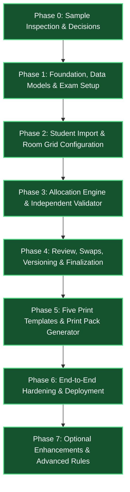
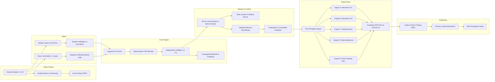

# Implementation Tasks — Examination Seating Arrangement & Print Pack Generator

This document establishes the atomic, phase-based implementation tasks for building the **Examination Seating Arrangement & Print Pack Generator** web application, directly derived from [`Exam_Seating_Arrangement_PRD.md`](file:///c:/AI%20Pro/seatingplan/Exam_Seating_Arrangement_PRD.md).

---

## 1. Phase Dependency Graph

### Detailed Component Dependencies

---

## Phase 0: Sample Inspection, Specifications & Architectural Decisions

> **PRD Reference:** Section 10 (Phase 0), Section 4.7, Section 13  
> **Goal:** Inspect institutional sample sheets, formulate exact field mappings, and establish architectural ground rules before document implementation.  
> **Exit Criteria:** Allocation semantics, bench orientation, and document field mappings are unambiguous.

- [x] **TASK-0.1: Institutional Sample Sheet Analysis & Specification Matrix**
  - **Goal**: Document the required fields, layouts, groupings, and signature areas for all five required institutional output sheets.
  - **PRD Reference**: Section 4.7 (Outputs A through E), Section 10 (Phase 0).
  - **Deliverables**: Specification mapping document in `src/export/templates/README.md`.
  - **Inputs / Dependencies**: Uploaded institutional sample files (`Sample.xlsx` / PDF samples).
  - **Acceptance Criteria**: Defined matrix detailing exact headers, column orders, handwriting signature spaces, and grouping rules for:
    - Output A: Attendance Sheet #1 (hall-wise, register-number ordered, signature space)
    - Output B: Attendance Sheet #2 (subject/room-wise attendance with additional sheet tracking)
    - Output C: Seating Arrangement Sheet (high-contrast room & roll range notice board format)
    - Output D: Daily Attendance Sheet (session/date/exam-level attendance summary)
    - Output E: Room Seating Plan (visual bench layout diagram, seat orientation, position legend)

- [x] **TASK-0.2: Clarify Allocation Rules & Bench Orientation Semantics**
  - **Goal**: Formulate exact mathematical and spatial definitions for bench occupancy and orientation.
  - **PRD Reference**: Section 4.4, Section 10 (Phase 0 item 3 & 4).
  - **Deliverables**: Rule specification comments and type documentation in `src/models/arrangement.ts`.
  - **Inputs / Dependencies**: PRD Section 4.4 definitions.
  - **Acceptance Criteria**:
    - Bench occupancy is defined strictly as occupants of the *same bench* (1 to 3 ordered seats).
    - Multi-person bench rule: for any pair of students on the same bench, conflict if `subjectCode` matches **OR** (`branch` matches **AND** `semester` matches).
    - Left-to-right seat orientation convention established (seat index 0 = leftmost from candidate's view facing front board).
    - Single candidate per register number per examination sitting established.

---

## Phase 1: Foundation, Data Models & Examination Setup

> **PRD Reference:** Section 4.1, Section 5, Section 10 (Phase 1)  
> **Goal:** Build typed domain models adhering to PRD data schema, state management with snapshot versioning, and exam setup CRUD wizard.  
> **Acceptance Criteria:** Exam can be created, edited, duplicated, and archived; duration and end-time validation works; state survives browser reload.

- [x] **TASK-1.1: Core TypeScript Domain Models & Zod Schemas**
  - **Goal**: Define domain models adhering strictly to PRD Section 5.
  - **PRD Reference**: Section 5 (Suggested Data Model), Section 4.1, Section 4.4.
  - **Deliverables**:
    - `src/models/exam.ts` (`Exam`: id, name, date, session, startTime, endTime, institutionName, institutionLocation, examCode, documentCode, status: `draft` | `active` | `archived`).
    - `src/models/student.ts` (`ExamCandidate`: id, examId, registerNumber [string, preserves leading zeros], name, branch, semester, subjectCode, sourceRow).
    - `src/models/classroom.ts` (`Room`: id, name, rows, columns, studentsPerBench [1, 2, or 3], maxCapacity, roomOrder, active, blockedBenches: `BenchPosition[]`, blockedSeats: `SeatPosition[]`).
    - `src/models/arrangement.ts` (`AllocationVersion`: id, examId, versionNumber, status: `draft` | `finalized` | `superseded`, algorithmVersion, seed, generatedAt, summary: `ValidationSummary`; `SeatAssignment`: allocationVersionId, candidateId, roomId, row, column, position).
  - **Inputs / Dependencies**: PRD Section 5.
  - **Acceptance Criteria**: All models compile with strict TypeScript; Zod schemas validate required fields, time format (`HH:mm`), and non-empty strings.

- [x] **TASK-1.2: Zustand Global Store with Allocation Versioning & Persistence**
  - **Goal**: Implement global state management supporting draft auto-save, multiple allocation versions, and finalization locking.
  - **PRD Reference**: Section 4.6, Section 5 (`AllocationVersion`), Section 10 (Phase 1).
  - **Deliverables**: `src/store/appStore.ts` and `src/storage/draftStorage.ts`.
  - **Inputs / Dependencies**: TASK-1.1.
  - **Acceptance Criteria**:
    - Store manages active exam, candidate pool, rooms, allocation versions (`AllocationVersion[]`), active version ID, and UI navigation step.
    - State updates auto-save to browser `localStorage` with debouncing (500ms).
    - Supports creating new version branches when edits are made after generation.

- [x] **TASK-1.3: Examination Setup Form & Time/Duration Validation**
  - **Goal**: Create exam creation, editing, and duplication interface with time validation.
  - **PRD Reference**: Section 4.1.
  - **Deliverables**: `src/components/exam/ExamForm.tsx` and `src/pages/ExamDetailsScreen.tsx`.
  - **Inputs / Dependencies**: TASK-1.1, TASK-1.2.
  - **Acceptance Criteria**:
    - Form captures: Exam Name, Date, Session (FN/AN), Start Time, End Time or Duration, Institution Name, Location, Document Code.
    - Validates that End Time is after Start Time (warns if overnight unless explicitly toggled).
    - Provides "Duplicate Exam" action to clone configuration for next session.
    - Supports exam status toggle (`draft`, `active`, `archived`).

- [x] **TASK-1.4: Wizard Shell Navigation & Progress Tracker**
  - **Goal**: Build wizard header and workflow progress navigation bar.
  - **PRD Reference**: Section 3 (Workflow), Section 6 (UI/Navigation).
  - **Deliverables**: `src/components/wizard/WizardHeader.tsx` and `src/components/wizard/ProgressIndicator.tsx`.
  - **Inputs / Dependencies**: TASK-1.2.
  - **Acceptance Criteria**: Displays sequential workflow: 1. Exam Setup -> 2. Students -> 3. Rooms -> 4. Rules & Readiness -> 5. Generate -> 6. Review & Finalize -> 7. Print Pack. Steps lock until prerequisites are met.

---

## Phase 2: Student Import & Room Configuration

> **PRD Reference:** Section 4.2, Section 4.3, Section 10 (Phase 2)  
> **Goal:** XLSX/CSV candidate import with leading-zero preservation and duplicate handling; Room visual grid editor supporting 1 to 3 students per bench, blocked seats, and physical vs configured capacity.  
> **Acceptance Criteria:** Duplicates and missing fields reported before committing; leading zeros preserved; room capacity cannot exceed physical seats; visual grid matches physical room geometry.

- [x] **TASK-2.1: Robust XLSX & CSV Candidate Parser Engine**
  - **Goal**: Build file importer parsing `.xlsx` and `.csv` student spreadsheets while strictly preserving register numbers as raw strings.
  - **PRD Reference**: Section 4.2.
  - **Deliverables**: `src/import/csvImporter.ts` and `src/import/excelImporter.ts`.
  - **Inputs / Dependencies**: SheetJS (`xlsx`) and `papaparse`.
  - **Acceptance Criteria**:
    - Preserves register number strings verbatim (e.g. `"0042"`, `"09CS01"` never converted to integer `42`).
    - Extracts all candidate rows with raw column keys regardless of case or whitespace.
    - Handles multi-sheet Excel workbooks with sheet selector if multiple sheets exist.

- [x] **TASK-2.2: Interactive Column Mapping Wizard**
  - **Goal**: Allow coordinators to map uploaded spreadsheet headers to mandatory domain fields.
  - **PRD Reference**: Section 4.2.
  - **Deliverables**: `src/components/students/ColumnMappingModal.tsx`.
  - **Inputs / Dependencies**: TASK-2.1.
  - **Acceptance Criteria**:
    - Maps columns for: Register Number (mandatory), Candidate Name (mandatory), Branch (mandatory), Semester (mandatory), Subject Code (mandatory).
    - Intelligent auto-detection matches common variations (e.g., `Reg No`, `RegisterNumber`, `Roll No`, `SubCode`, `CourseCode`).
    - Disallows proceeding if any mandatory field is unmapped.

- [x] **TASK-2.3: Candidate Data Normalization, Duplicate Detection & Validation Engine**
  - **Goal**: Validate uploaded candidate records for missing fields, malformed rows, and duplicate register numbers.
  - **PRD Reference**: Section 4.2, Section 4.4 (C4, C6).
  - **Deliverables**: `src/import/studentValidator.ts`.
  - **Inputs / Dependencies**: TASK-2.2.
  - **Acceptance Criteria**:
    - Trims and case-normalizes `branch`, `semester`, and `subjectCode` for internal comparisons while preserving original casing for display.
    - Flags missing mandatory values with exact spreadsheet row numbers.
    - Identifies duplicate register numbers across uploaded dataset and provides policy choices: Reject duplicates, Overwrite, or Keep first.
    - Generates downloadable CSV error report containing invalid rows and error reasons.

- [x] **TASK-2.4: Candidate Management Table & Import Review Screen**
  - **Goal**: Interactive UI for reviewing imported candidates, editing records inline, and reviewing branch/semester distributions.
  - **PRD Reference**: Section 4.2, Section 6.
  - **Deliverables**:
    - `src/components/students/StudentTable.tsx`
    - `src/components/students/BranchSummaryCard.tsx`
    - `src/pages/StudentsScreen.tsx`
  - **Inputs / Dependencies**: TASK-2.3.
  - **Acceptance Criteria**:
    - Displays total candidate count, distribution by branch, semester, and subject code.
    - Provides search/filter by register number, branch, semester, or subject code.
    - Allows manual inline editing of candidate records and adding individual walk-in candidates.
    - Allows "Replace All" or "Append to List" import modes.

- [x] **TASK-2.5: Room CRUD & Physical Bench Dimension Controls**
  - **Goal**: Manage examination rooms/halls with row, column, students-per-bench, and room order attributes.
  - **PRD Reference**: Section 4.3.
  - **Deliverables**: `src/components/classrooms/ClassroomFormModal.tsx` and `src/pages/ClassroomsScreen.tsx`.
  - **Inputs / Dependencies**: TASK-1.1, TASK-1.2.
  - **Acceptance Criteria**:
    - Allows setting Room Identifier/Name, Bench Rows (1-20), Bench Columns (1-20), Students per Bench (1, 2, or 3), Room Sequence/Order, and Active toggle.
    - Enforces Configured Max Capacity <= Effective Physical Capacity.
    - Supports presets for common institutional hall templates.

- [x] **TASK-2.6: Interactive Visual Bench & Seat Grid Editor**
  - **Goal**: Visual room layout grid enabling individual seat or entire bench blocking/unblocking.
  - **PRD Reference**: Section 4.3.
  - **Deliverables**: `src/components/classrooms/SeatGrid.tsx` and `src/utils/capacityCalculator.ts`.
  - **Inputs / Dependencies**: TASK-2.5.
  - **Acceptance Criteria**:
    - Displays bench cells with 1, 2, or 3 distinct seat position slots per bench.
    - Clicking a seat or bench toggles between Available and Blocked/Unavailable (visual hatch pattern).
    - Dynamically computes and displays:
      - `Theoretical Capacity = Rows × Columns × StudentsPerBench`
      - `Effective Physical Capacity = Theoretical Capacity - Blocked Seats`
      - `Configured Max Capacity`
    - Changing room geometry after an allocation exists flags the allocation as invalid/needs regeneration.

---

## Phase 3: Allocation Engine & Independent Validator

> **PRD Reference:** Section 4.4, Section 4.5, Section 10 (Phase 3), Section 13  
> **Goal:** Deterministic, constraint-aware seating allocator enforcing hard constraints C1–C6; decoupled independent post-allocation validator; actionable infeasibility reporting.  
> **Acceptance Criteria:** Every candidate assigned once or explicitly reported as unassigned; capacity and all bench constraints verified by validator; validator catches corrupted plans; identical input and seed produces identical layout.

- [x] **TASK-3.1: Capacity & Pre-Allocation Gatekeeper Engine**
  - **Goal**: Execute pre-checks verifying candidate count against selected rooms' effective capacity before running allocator.
  - **PRD Reference**: Section 4.5.
  - **Deliverables**: `src/algorithms/capacityValidator.ts` and `src/components/generate/ReadinessCard.tsx`.
  - **Inputs / Dependencies**: TASK-2.4, TASK-2.6.
  - **Acceptance Criteria**:
    - Verifies: `Total Eligible Candidates <= Sum of Selected Rooms' Effective Capacities`.
    - If total candidates exceed capacity, blocks allocation with exact deficit count and suggests adding rooms or increasing room selections.
    - Verifies zero uncorrected missing fields (C6) and zero unresolved duplicate register numbers.

- [x] **TASK-3.2: Room-Fill & Candidate Ordering Strategy Engine**
  - **Goal**: Implement strategies for distributing candidates across rooms prior to seat placement.
  - **PRD Reference**: Section 4.5.
  - **Deliverables**: `src/algorithms/roomAllocation.ts`.
  - **Inputs / Dependencies**: TASK-3.1.
  - **Acceptance Criteria**:
    - Supported Room Fill Strategies:
      1. *Sequential Room Order*: fills rooms in configured room sequence order until capacity is reached.
      2. *Balanced Distribution*: evenly distributes candidates across rooms proportionally to room capacities.
    - Candidate Sorting Heuristic: sorts candidates by subject code and branch group size (largest conflicting cohort first) to maximize placement success.

- [x] **TASK-3.3: Deterministic Constraint-Aware Allocation Engine (Backtracking / CSP)**
  - **Goal**: Implement deterministic, rule-based placement engine satisfying hard constraints C1–C5.
  - **PRD Reference**: Section 4.4, Section 4.5, Section 13 (No LLM for seating decisions).
  - **Deliverables**: `src/algorithms/seatingGenerator.ts` and `src/utils/random.ts`.
  - **Inputs / Dependencies**: TASK-3.2.
  - **Hard Constraints Enforced**:
    - **C1 Capacity**: Room assignment count <= room's effective and configured capacity.
    - **C2 Subject**: No two occupants of the *same bench* share a subject code.
    - **C3 Branch/Semester**: No two occupants of the *same bench* share both normalized branch and semester.
    - **C4 Unique Assignment**: Each candidate appears at most once; all others reported unassigned.
    - **C5 Valid Physical Seat**: Only non-blocked, available bench positions assigned.
  - **Acceptance Criteria**:
    - Pairwise verification for 2- and 3-student benches: compares every occupant pair `(Seat 1, Seat 2)`, `(Seat 1, Seat 3)`, `(Seat 2, Seat 3)`.
    - Algorithm is deterministic: same inputs and random seed generate identical seat assignments.
    - Generates progress callbacks with candidate count and room occupancy metrics without locking UI.

- [x] **TASK-3.4: Decoupled Independent Post-Allocation Validator**
  - **Goal**: Build an independent validator module that evaluates any seating arrangement strictly from scratch.
  - **PRD Reference**: Section 4.4, Section 4.5, Section 10 (Phase 3).
  - **Deliverables**: `src/algorithms/independentValidator.ts`.
  - **Inputs / Dependencies**: TASK-1.1, TASK-3.3.
  - **Acceptance Criteria**:
    - Evaluates complete allocation against constraints C1, C2, C3, C4, C5 without relying on allocator state.
    - Returns structured validation report: `isValid: boolean`, `violations: ViolationDetail[]`, `summaryMetrics`.
    - Unit tests include intentionally corrupted mock allocations (e.g. swapped same-subject students onto same bench, overloaded room capacity, duplicate candidate); validator must catch 100% of corruptions.
    - UI displays success only if independent validator returns `isValid === true`.

- [x] **TASK-3.5: Allocation Infeasibility & Unassigned Candidate Reporting**
  - **Goal**: Accurately diagnose when an arrangement cannot be completed without violations and present actionable options.
  - **PRD Reference**: Section 4.5.
  - **Deliverables**: `src/algorithms/infeasibilityAnalyzer.ts` and `src/components/generate/InfeasibilityReportModal.tsx`.
  - **Inputs / Dependencies**: TASK-3.3, TASK-3.4.
  - **Acceptance Criteria**:
    - Distinguishes capacity shortages from mathematical pigeonhole conflicts (e.g., one subject code exceeds 50% of available bench slots in 2-person bench rooms).
    - Explicitly lists unassigned candidates with specific root cause (e.g., "No compatible bench companion found").
    - Provides actionable resolution suggestions: add rooms, change bench occupancy, or inspect candidate distribution.

---

## Phase 4: Review, Swaps, Versioning & Finalization

> **PRD Reference:** Section 4.6, Section 5, Section 10 (Phase 4)  
> **Goal:** Interactive room visualizer, instant candidate/seat search, validator-guarded manual moves/swaps, version tracking, and immutable finalization locking.  
> **Acceptance Criteria:** Invalid manual move rejected with clear explanation; valid move updates map and metrics; finalized plan is locked; post-finalization edit creates new version and warns of superseded print packs.

- [x] **TASK-4.1: Room Visual Grid Reviewer & Bench Detail Inspector**
  - **Goal**: Visual interactive room seating plan displaying assigned candidates with bench details.
  - **PRD Reference**: Section 4.6.
  - **Deliverables**: `src/components/review/RoomVisualReview.tsx` and `src/components/review/BenchDetailPopover.tsx`.
  - **Inputs / Dependencies**: TASK-3.3, TASK-3.4.
  - **Acceptance Criteria**:
    - Renders room grid with row, column, and bench cell boundaries.
    - Each occupied seat shows register number, branch tag, and subject code.
    - Hovering or clicking a bench displays full candidate details: Register Number, Name, Branch, Semester, Subject Code for each occupant.
    - Clearly marks empty seats and blocked positions.

- [x] **TASK-4.2: Candidate & Seat Finder Search Bar**
  - **Goal**: Rapid search utility to locate any candidate or bench instantly.
  - **PRD Reference**: Section 4.6.
  - **Deliverables**: `src/components/review/CandidateSearchBar.tsx`.
  - **Inputs / Dependencies**: TASK-4.1.
  - **Acceptance Criteria**:
    - Type-ahead search by candidate Name or Register Number.
    - Selecting candidate switches to their assigned room tab, scrolls to the bench, and applies an animated highlight to the seat.

- [x] **TASK-4.3: Validator-Guarded Manual Move & Swap Engine**
  - **Goal**: Enable coordinator to manually move a student to an empty seat or swap two students, enforcing hard constraints.
  - **PRD Reference**: Section 4.5, Section 4.6.
  - **Deliverables**: `src/components/review/ManualSwapModal.tsx` and `src/algorithms/swapValidator.ts`.
  - **Inputs / Dependencies**: TASK-3.4, TASK-4.1.
  - **Acceptance Criteria**:
    - Selecting Seat A and Seat B opens Swap Preview dialog.
    - Runs `independentValidator` against the proposed swap.
    - If swap introduces C1, C2, or C3 violations, the "Confirm Swap" button is blocked with explicit error message (e.g., "Cannot swap: Register No 21CS04 shares subject code CS301 with bench mate 21CS12").
    - Confirmed valid swap updates active allocation and recalculates statistics.

- [x] **TASK-4.4: Allocation Versioning, Finalization Lock & Superseded State Engine**
  - **Goal**: Manage immutable allocation version snapshots and protect against stale print packs.
  - **PRD Reference**: Section 4.6, Section 5 (`AllocationVersion`).
  - **Deliverables**: `src/store/versionManager.ts` in `src/pages/ReviewScreen.tsx`.
  - **Inputs / Dependencies**: TASK-1.2, TASK-4.3.
  - **Acceptance Criteria**:
    - "Finalize Allocation" action locks the current version (marks status `finalized`, timestamps snapshot, creates immutable record).
    - Attempting any manual move or room change on a finalized allocation prompts: "Finalized allocation is locked. Creating a new version (v2) will mark v1 as superseded."
    - Superseded versions display a prominent yellow/red banner: "Warning: This allocation has been superseded by Version X."

---

## Phase 5: Five Print Templates & Print Pack Generator

> **PRD Reference:** Section 4.7 (Outputs A through E), Section 10 (Phase 5)  
> **Goal:** Reusable print template engine rendering the five institutional sheets with exact fields, handwriting spaces, crisp notice typography, combined PDF print pack, and CSV/XLSX export.  
> **Acceptance Criteria:** Outputs derive strictly from same finalized allocation; table headers repeat; no clipped text or blank pages; seating notice register numbers large and high-contrast; room plan has orientation legend.

- [x] **TASK-5.1: Reusable Print Template System & Layout Framework**
  - **Goal**: Build modular HTML/CSS print template rendering framework supporting A4 Portrait and Landscape modes.
  - **PRD Reference**: Section 4.7.
  - **Deliverables**: `src/export/templates/PrintContainer.tsx` and `src/styles/printEngine.css`.
  - **Inputs / Dependencies**: TASK-4.4.
  - **Acceptance Criteria**:
    - Enforces standard A4 page dimensions, margins (12mm/15mm), page-break rules (`page-break-after: always`, `page-break-inside: avoid`).
    - Standard institutional header component: Institution Name, Department/Office, Examination Title, Date, Session, Document Code.
    - Page numbering format ("Page X of Y") and repeated table headers across pages (`thead { display: table-header-group; }`).
    - Crisp high-contrast black-and-white print output without relying on color.

- [x] **TASK-5.2: Output A — Attendance Sheet #1 Template**
  - **Goal**: Implement printable Attendance Sheet #1 template.
  - **PRD Reference**: Section 4.7 (Output A).
  - **Deliverables**: `src/export/templates/AttendanceSheet1.tsx`.
  - **Inputs / Dependencies**: TASK-5.1.
  - **Acceptance Criteria**:
    - Form layout: Room No, Date, Session, Candidate List sorted by room/bench/register number.
    - Columns: Sl. No., Register Number, Candidate Name, Branch, Subject Code, Answer Book No., Student Signature.
    - Generous handwriting and signature space (minimum 28px row height).
    - Summary footer for Invigilator Name, Number of Candidates Present/Absent, and Invigilator Signature.

- [x] **TASK-5.3: Output B — Attendance Sheet #2 Template**
  - **Goal**: Implement printable Attendance Sheet #2 template.
  - **PRD Reference**: Section 4.7 (Output B).
  - **Deliverables**: `src/export/templates/AttendanceSheet2.tsx`.
  - **Inputs / Dependencies**: TASK-5.1.
  - **Acceptance Criteria**:
    - Implemented as distinct template matching institutional sample #2 layout.
    - Columns for Main Answer Sheet Number, Additional Sheet Serial Numbers, Total Sheets Issued, and Student Signature.
    - Room-wise grouping with separate page breaks between rooms.

- [x] **TASK-5.4: Output C — Seating Arrangement Sheet (Notice Board Format)**
  - **Goal**: Implement high-contrast seating arrangement summary sheet designed for public notice boards.
  - **PRD Reference**: Section 4.7 (Output C).
  - **Deliverables**: `src/export/templates/SeatingNoticeSheet.tsx`.
  - **Inputs / Dependencies**: TASK-5.1.
  - **Acceptance Criteria**:
    - Large, prominent, bold register number typography (minimum 14pt-18pt) legible from distance.
    - Groups candidates by Room, Branch, and Semester.
    - Formats register numbers into continuous ranges (e.g. `21CS001 to 21CS025`) and clean comma-separated lists for gaps.
    - Does not shrink text to fit single page; cleanly paginates across multi-page notice sheets.
    - Omits unnecessary personal data to preserve privacy on public notice boards.

- [x] **TASK-5.5: Output D — Daily Attendance Sheet Template**
  - **Goal**: Implement Daily Attendance Sheet template.
  - **PRD Reference**: Section 4.7 (Output D).
  - **Deliverables**: `src/export/templates/DailyAttendanceSheet.tsx`.
  - **Inputs / Dependencies**: TASK-5.1.
  - **Acceptance Criteria**:
    - Daily exam-wide/hall-wide attendance record format.
    - Columns: Room Number, Course/Subject Code, Branch, Registered Count, Present Count, Absent Count, Absentee Register Numbers list.
    - Blank signature blocks for Chief Superintendent / Exam Cell In-Charge.

- [x] **TASK-5.6: Output E — Room Seating Plan / Notice-Board Layout Diagram**
  - **Goal**: Implement visual room seating grid diagram for classroom door notice boards.
  - **PRD Reference**: Section 4.7 (Output E).
  - **Deliverables**: `src/export/templates/RoomSeatingPlanSheet.tsx`.
  - **Inputs / Dependencies**: TASK-5.1.
  - **Acceptance Criteria**:
    - Visual spatial diagram matching room bench rows and columns.
    - Each bench cell clearly displays Bench Row/Column coordinate, Seat Positions (1 to 3), and occupant Register Numbers.
    - Clear front-board / teacher's desk orientation indicator.
    - Orientation legend clearly printed: "Seat 1: Leftmost from student facing front board; Seat 2: Rightmost" (or 3-seat convention).
    - Blocked seats / empty seats clearly marked.
    - Includes a structured tabular fallback view on the sheet.

- [x] **TASK-5.7: Combined PDF Print Pack & Allocation CSV/XLSX Export Engine**
  - **Goal**: Generate combined PDF document containing all 5 sheets and raw allocation data spreadsheet.
  - **PRD Reference**: Section 4.7 (Combined print pack & CSV/XLSX).
  - **Deliverables**: `src/export/pdfPackGenerator.ts` and `src/export/csvAllocationExporter.ts`.
  - **Inputs / Dependencies**: TASK-5.2 through TASK-5.6.
  - **Acceptance Criteria**:
    - "Download Combined Print Pack (PDF)" creates a single compiled PDF file containing:
      1. Seating Arrangement Notice Sheets
      2. Room Seating Plans
      3. Attendance Sheets #1
      4. Attendance Sheets #2
      5. Daily Attendance Sheets
    - Includes native browser `window.print()` trigger with print preview CSS.
    - "Export Allocation Data" produces CSV and XLSX files with columns: `Exam Name`, `Date`, `Session`, `Room`, `Row`, `Column`, `Position`, `Register Number`, `Name`, `Branch`, `Semester`, `Subject Code`.

---

## Phase 6: End-to-End Hardening, Security & Deployment

> **PRD Reference:** Section 7, Section 8, Section 10 (Phase 6), Section 11, Section 12  
> **Goal:** High-volume scalability testing, candidate data privacy protections, accessibility, and end-to-end integration verification.  
> **Acceptance Criteria:** Full workflow works end-to-end; 2,000+ candidate dataset processed smoothly; unauthorized data leakage prevented; print PDFs verified on multiple screen sizes and printers.

- [x] **TASK-6.1: High-Volume Scale & Performance Benchmark Test (2,000+ Candidates)**
  - **Goal**: Test system responsiveness and allocator performance with 2,000 synthetic candidate records.
  - **PRD Reference**: Section 8 (Performance target: 2,000 rows), Section 11.
  - **Deliverables**: `tests/scaleBenchmark.test.ts` and synthetic dataset generator in `src/utils/mockDataGenerator.ts`.
  - **Inputs / Dependencies**: TASK-3.3, TASK-5.7.
  - **Acceptance Criteria**:
    - Importing 2,000 rows executes in < 2 seconds.
    - Allocator generates valid arrangement across 15+ rooms with deterministic seed within configurable timeout (default 10s).
    - Memory usage remains stable without crashing browser tab.

- [x] **TASK-6.2: Comprehensive Constraint & Edge Case Verification Suite**
  - **Goal**: Execute automated unit and integration tests covering all PRD edge cases.
  - **PRD Reference**: Section 7 (Edge cases), Section 11 (Test plan).
  - **Deliverables**: `tests/prdEdgeCases.test.ts`.
  - **Inputs / Dependencies**: TASK-3.4, TASK-4.3.
  - **Edge Cases Tested**:
    - Single-branch candidate pool in multi-student bench rooms (verifies failure / unassigned reporting, no silent C3 violations).
    - Concentrated subject codes (>50% same subject).
    - Leading zeros in register numbers (e.g. `00123`) maintained through import, review, and export.
    - All-blocked seats or insufficient capacity scenarios.
    - Odd candidate numbers with partially occupied final bench.
    - Candidate with missing semester/subject code (rejected at pre-check).
    - Long candidate names (50+ chars) in print templates without text clipping.
  - **Acceptance Criteria**: 100% of edge case test assertions pass.

- [x] **TASK-6.3: Candidate Data Privacy, Upload Sanitization & Security Hardening**
  - **Goal**: Protect personal student data and sanitize spreadsheet uploads.
  - **PRD Reference**: Section 8 (Privacy/security).
  - **Deliverables**: `src/utils/securitySanitizer.ts`.
  - **Inputs / Dependencies**: TASK-2.1.
  - **Acceptance Criteria**:
    - Disallows spreadsheet macro execution (pure data extraction only).
    - Strips formula injection vulnerabilities (e.g. cells starting with `=`, `+`, `-`, `@`).
    - Avoids logging full personal student records in client console.
    - Provides explicit "Clear All Student Data" privacy action in settings.

- [x] **TASK-6.4: Accessibility & Print Calibration Verification**
  - **Goal**: Ensure keyboard operability, contrast compliance, and physical printer alignment.
  - **PRD Reference**: Section 8 (Accessibility), Section 4.7.
  - **Deliverables**: `tests/accessibilityAudit.md` and print styles adjustments.
  - **Inputs / Dependencies**: TASK-5.1.
  - **Acceptance Criteria**:
    - All interactive wizard forms and modals are keyboard navigable with focus rings.
    - Screen reader ARIA labels on visual bench grid cells and seat status indicators.
    - Print output tested on physical printer / standard PDF viewer: margins align, headers repeat, barcode/text razor-sharp.

- [x] **TASK-6.5: User Operational Manual & Deployment Packaging**
  - **Goal**: Produce user documentation, troubleshooting guide, and production build verification.
  - **PRD Reference**: Section 10 (Phase 6).
  - **Deliverables**: `USER_GUIDE.md` and production build validation.
  - **Inputs / Dependencies**: TASK-6.1 through TASK-6.4.
  - **Acceptance Criteria**:
    - `npm run build` succeeds with zero TypeScript errors or linter warnings.
    - `npm test` runs all unit, integration, and allocator suites cleanly.
    - Step-by-step documentation for exam coordinators on importing, seating generation, manual swap rules, and print pack generation.

---

## Phase 7: Optional Enhancements (Future Scope)

> **PRD Reference:** Section 10 (Phase 7), Section 4.4  
> **Goal:** Post-MVP institutional capabilities to be scheduled after Phase 6 sign-off.

- [x] **TASK-7.1: Neighboring-Bench & Diagonal Adjacency Constraint Engine**
  - **Goal**: Prohibit same-subject or same-branch students on neighboring benches across horizontal, vertical, and diagonal spatial offsets.
  - **PRD Reference**: Section 4.4, Section 10 (Phase 7).
  - **Deliverables**: Extended `src/models/arrangement.ts`, `src/algorithms/seatGraph.ts`, `src/algorithms/seatingGenerator.ts`, `src/algorithms/independentValidator.ts` (`C7_ADJACENT_BENCH_CONFLICT`), and `src/components/rules/RulesForm.tsx`.
  - **Acceptance Criteria**:
    - Allocator checks bench-level connectivity (`addBenchNeighbors`), preventing same-branch or same-subject placement on adjacent desks.
    - Independent validator reports `C7_ADJACENT_BENCH_CONFLICT` violations.
    - Verified by automated tests in `tests/phase7Adjacency.test.ts`.

- [x] **TASK-7.2: Multi-User Authentication & Role-Based Access Control**
  - **Goal**: Implement institutional role permissions (Admin, Coordinator, Invigilator) with persistent session management.
  - **PRD Reference**: Section 8 (Security & Multi-user), Section 10 (Phase 7).
  - **Deliverables**: `src/models/user.ts`, `src/store/authStore.ts`, and `src/components/auth/UserRoleSwitcher.tsx` mounted in navigation bar.
  - **Acceptance Criteria**:
    - Granular permission matrix (`MANAGE_SETTINGS`, `GENERATE_SEATING`, `FINALIZE_VERSION`, `PRINT_DOCUMENTS`, `MARK_ATTENDANCE`).
    - Seamless role switcher for testing and production deployment with safe local fallback.
    - Verified by automated tests in `tests/phase7AuthRbac.test.ts`.

- [x] **TASK-7.3: Timetable Clash Detection & Multi-Sitting Exam Rostering**
  - **Goal**: Detect candidate conflicts across multi-paper exam timetables and roster valid multi-sitting days.
  - **PRD Reference**: Section 4.4, Section 7 (Edge cases).
  - **Deliverables**: `src/algorithms/timetableClashDetector.ts` and `src/components/exam/TimetableClashBanner.tsx` mounted in Exam Setup.
  - **Acceptance Criteria**:
    - Flags critical same-session paper clashes with actionable resolution advice.
    - Accurately identifies valid multiple sitting sessions (FN + AN) on identical exam dates.
    - Verified by automated tests in `tests/phase7TimetableClash.test.ts`.

- [x] **TASK-7.4: Invigilator Duty Rostering Engine**
  - **Goal**: Automated invigilator faculty assignment based on room candidate counts, faculty seniority weighting, and department conflict avoidance.
  - **PRD Reference**: Section 10 (Phase 7), Section 4.7.
  - **Deliverables**: `src/algorithms/invigilatorRostering.ts` and `src/components/invigilator/InvigilatorDutyChart.tsx` integrated in Review screen.
  - **Acceptance Criteria**:
    - Roster assigns 1 invigilator per 30 candidates (minimum 1 per room) plus room-specific Chief Superintendent appointment.
    - Enforces department neutrality so faculty do not invigilate exams from their own department.
    - Prevents faculty double-booking in multiple halls during identical sessions.
    - Verified by automated tests in `tests/phase7InvigilatorRostering.test.ts`.

- [x] **TASK-7.5: Visual Print Template Customizer**
  - **Goal**: Visual editor for institutional branding, logo upload, signature block titles, font scale, and layout density.
  - **PRD Reference**: Section 4.7, Section 10 (Phase 7).
  - **Deliverables**: `src/models/templateConfig.ts` and `src/components/export/TemplateCustomizerModal.tsx` wired into Export Center.
  - **Acceptance Criteria**:
    - Real-time institutional header preview modal with logo file reader and scale controls.
    - Dynamic typography and density adjustments (Compact / Standard / Spacious).
    - Verified by automated tests in `tests/phase7TemplateCustomizer.test.ts`.

- [x] **TASK-7.6: Barcode & QR Code Integration for Student Attendance**
  - **Goal**: Pure vector SVG Code 39 1D barcodes and 2D QR matrix generation on official attendance registers and real-time handheld scanner verifier.
  - **PRD Reference**: Section 4.7 (Output A & B), Section 10 (Phase 7).
  - **Deliverables**: `src/utils/barcodeGenerator.ts`, `src/components/attendance/BarcodeScannerModal.tsx`, integrated into `AttendanceSheet1.tsx` and `AttendanceSheet2.tsx`, and wired into `ExportScreen.tsx`.
  - **Acceptance Criteria**:
    - Generates crisp vector SVG Code 39 barcodes for register numbers without external web fonts or CDN scripts.
    - Generates deterministic 2D QR matrix verification SVGs with corner finder patterns.
    - Interactive modal supports keyboard wedge handheld barcode scanners, instant room/seat lookup, and real-time attendance tallying.
    - Verified by automated tests in `tests/phase7BarcodeAttendance.test.ts`.

---

## 2. Definition of Done Checklist

For every atomic task, the following criteria must be satisfied prior to marking complete:
1. **Requirements Satisfied:** Implements the exact specifications in `Exam_Seating_Arrangement_PRD.md`.
2. **Deterministic & Rule-Based:** No stochastic hallucinations or LLM-driven seating decisions.
3. **Type Safety:** TypeScript strict mode enabled with zero `any` types.
4. **Validation Integrity:** Independent validator passes; corrupted inputs caught.
5. **Print Fidelity:** Output documents tested for layout alignment, page breaks, and legibility.
6. **Automated Tests:** Unit or integration test assertions accompany the feature.
