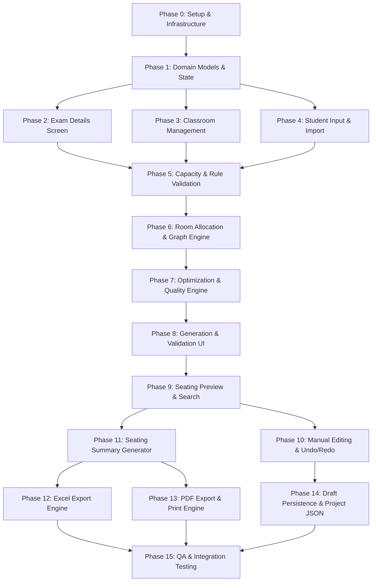

# Implementation Tasks — Exam Seating Arrangement Generator

This document defines the atomic, phase-based implementation tasks for building the **Exam Seating Arrangement Generator** web application, derived from [`exam_seating_arrangement_generator_PRD.md`](file:///c:/AI%20Pro/seatingplan/exam_seating_arrangement_generator_PRD.md).

---

## Task Dependency Overview

---

## Phase 0: Project Setup & Architecture Foundations

### Prerequisites / Dependencies
- Node.js environment installed
- Access to repository root `c:\AI Pro\seatingplan`

- [ ] **TASK-0.1: Initialize Vite React TypeScript Project**
  - **Goal**: Scaffolding the React + TypeScript frontend using Vite.
  - **Deliverables**: Configured `package.json`, `tsconfig.json`, `vite.config.ts`, `index.html`, and `src/App.tsx`.
  - **Dependencies**: None.
  - **Acceptance Criteria**: Running `npm run dev` starts the Vite dev server with zero TypeScript errors.

- [ ] **TASK-0.2: Configure Styling Infrastructure & Design System**
  - **Goal**: Setup Tailwind CSS with custom styling tokens (modern academic theme, glassmorphism, color palette).
  - **Deliverables**: `tailwind.config.js`, `postcss.config.js`, and `src/index.css` containing base CSS variables and font imports.
  - **Dependencies**: TASK-0.1
  - **Acceptance Criteria**: Tailwind utility classes work across components; design tokens for background, surfaces, primary academic blue/indigo gradients are active.

- [ ] **TASK-0.3: Implement Routing & Navigation Infrastructure**
  - **Goal**: Configure React Router DOM for wizard page routing and app navigation.
  - **Deliverables**: `src/router.tsx` setting up routes for `/`, `/exam`, `/classrooms`, `/students`, `/rules`, `/generate`, `/review`, `/preview`, `/export`.
  - **Dependencies**: TASK-0.1
  - **Acceptance Criteria**: Navigating between routes renders respective screen containers without full page reloads.

- [ ] **TASK-0.4: Build Shared Design System UI Component Library**
  - **Goal**: Implement reusable atomic UI components.
  - **Deliverables**: Reusable UI components in `src/components/ui/`:
    - `Button.tsx` (primary, secondary, danger, ghost variants with icons & loading states)
    - `Card.tsx` (elevated container with header and content slots)
    - `Input.tsx` (styled text input, number input, select with error states)
    - `Modal.tsx` (accessible dialog overlay with escape key / backdrop close)
    - `Badge.tsx` (status indicators: success green, warning yellow, error red, info blue)
    - `Tooltip.tsx` (hover info popovers)
  - **Dependencies**: TASK-0.2
  - **Acceptance Criteria**: All UI components render consistently with active focus states, accessible ARIA attributes, and smooth hover transitions.

- [ ] **TASK-0.5: Build Wizard Navigation Shell & Progress Bar Component**
  - **Goal**: Create header navigation and step-by-step progress indicator for the 7-step creation wizard.
  - **Deliverables**: `src/components/wizard/WizardHeader.tsx` and `src/components/wizard/ProgressIndicator.tsx`.
  - **Dependencies**: TASK-0.3, TASK-0.4
  - **Acceptance Criteria**: Wizard steps (1. Exam Details, 2. Classrooms, 3. Students, 4. Rules, 5. Generate, 6. Review, 7. Export) visually highlight current step, completed steps, and disable future invalid steps.

- [ ] **TASK-0.6: Create Placeholder Views for All Application Screens**
  - **Goal**: Wire up basic screen component structures to ensure clean route transitions.
  - **Deliverables**: Placeholder page files under `src/pages/`:
    - `Dashboard.tsx`
    - `ExamDetailsScreen.tsx`
    - `ClassroomsScreen.tsx`
    - `StudentsScreen.tsx`
    - `RulesScreen.tsx`
    - `GenerateScreen.tsx`
    - `ReviewScreen.tsx`
    - `PreviewScreen.tsx`
    - `ExportScreen.tsx`
  - **Dependencies**: TASK-0.3, TASK-0.5
  - **Acceptance Criteria**: Dashboard and wizard flow render with working step navigation and placeholder titles.

---

## Phase 1: Domain Models & Core State Management

### Prerequisites / Dependencies
- Phase 0 completed

- [x] **TASK-1.1: Define Exam Details Data Model & Zod Schema**
  - **Goal**: Create TypeScript interface and runtime validation schema for examination metadata.
  - **Deliverables**: `src/models/exam.ts` with `ExamDetails` type and `examDetailsSchema` Zod validation.
  - **Fields**: `examName`, `examDate`, `session` ('FN'|'AN'), `startTime`, `endTime`, `academicYear`, `semester`, `institutionName`, `institutionLocation`, `examCode`, `documentCode`.
  - **Dependencies**: TASK-0.1
  - **Acceptance Criteria**: Zod schema parses valid exam objects and outputs detailed field-level validation errors for missing mandatory fields (`examName`, `examDate`, `session`).

- [x] **TASK-1.2: Define Classroom & Seat Data Models**
  - **Goal**: Create TypeScript structures for classroom layouts, bench configurations, and seat positions.
  - **Deliverables**: `src/models/classroom.ts`.
  - **Types**: `SeatPosition`, `Classroom`, `SeatAvailabilityStatus`.
  - **Dependencies**: TASK-0.1
  - **Acceptance Criteria**: Models accurately represent grid layout (`rows`, `columns`, `studentsPerBench`), seat disabling maps (`disabledSeats: SeatPosition[]`), and calculated usable capacity.

- [x] **TASK-1.3: Define Student & Branch Data Models**
  - **Goal**: Create data structures for student records and branch aggregations.
  - **Deliverables**: `src/models/student.ts`.
  - **Types**: `Student`, `BranchInfo`, `StudentImportRaw`.
  - **Dependencies**: TASK-0.1
  - **Acceptance Criteria**: Correctly structures student attributes (`id`, `registerNumber`, `name`, `branch`, optional `section`/`department`) and branch summary metrics.

- [x] **TASK-1.4: Define Seating Arrangement & Validation Data Models**
  - **Goal**: Create structures for seat assignments, rules, conflict reports, and quality statistics.
  - **Deliverables**: `src/models/arrangement.ts`.
  - **Types**: `SeatingRules` (adjacency options), `AssignedSeat`, `SeatingArrangement`, `ConflictDetail`, `ValidationReport`.
  - **Dependencies**: TASK-1.1, TASK-1.2, TASK-1.3
  - **Acceptance Criteria**: Provides complete type safety for generated seating outputs, conflict definitions, and export-ready data shapes.

- [x] **TASK-1.5: Setup Zustand Global App State Store & Persist Middleware**
  - **Goal**: Build global state store to manage application state across all wizard screens.
  - **Deliverables**: `src/store/appStore.ts`.
  - **State Actions**: `setExamDetails`, `addClassroom`, `updateClassroom`, `deleteClassroom`, `setStudents`, `setRules`, `setArrangement`, `swapStudents`, `undo`, `redo`, `resetStore`.
  - **Dependencies**: TASK-1.1, TASK-1.2, TASK-1.3, TASK-1.4
  - **Acceptance Criteria**: State updates reliably trigger component re-renders, and Zustand store maintains complete serializability.

---

## Phase 2: Exam Details Screen (Screen 2)

### Prerequisites / Dependencies
- Phase 1 completed

- [x] **TASK-2.1: Build Exam Details Form Component**
  - **Goal**: Construct the interactive form UI for entering examination metadata.
  - **Deliverables**: `src/components/exam/ExamForm.tsx` in `src/pages/ExamDetailsScreen.tsx`.
  - **Dependencies**: TASK-0.4, TASK-1.1, TASK-1.5
  - **Acceptance Criteria**: Form displays input fields for Exam Name, Date Picker, Session Toggle (FN/AN), Institution Name (defaulted to 'ALBERTIAN INSTITUTE OF SCIENCE AND TECHNOLOGY'), Location ('KALAMASSERY'), Document Code ('AISAT/Form/QPM17/F4'), and optional fields.

- [x] **TASK-2.2: Implement Exam Form Validation & Real-Time Error Messaging**
  - **Goal**: Integrate Zod validation for instant field feedback on change/blur.
  - **Deliverables**: Validation hook integration in `ExamForm.tsx`.
  - **Dependencies**: TASK-2.1
  - **Acceptance Criteria**: Required fields highlight in red with helper text if empty; Save & Continue button remains disabled or triggers inline errors if invalid.

- [x] **TASK-2.3: Connect Exam Form to Zustand Store & Navigation Workflow**
  - **Goal**: Persist entered exam details into global state and advance wizard to Classrooms step.
  - **Deliverables**: Handler logic in `ExamDetailsScreen.tsx`.
  - **Dependencies**: TASK-2.2
  - **Acceptance Criteria**: Submitting valid exam details updates `store.exam`, enables Step 2 navigation, and navigates to `/classrooms`.

---

## Phase 3: Classroom Configuration & Visual Grid (Screen 3)

### Prerequisites / Dependencies
- Phase 1 completed

- [x] **TASK-3.1: Implement Classroom Usable Capacity Calculator Utility**
  - **Goal**: Write pure function to calculate net classroom capacity considering disabled seats.
  - **Deliverables**: `src/utils/capacityCalculator.ts`.
  - **Formula**: `usableCapacity = (rows * columns * studentsPerBench) - disabledSeats.length`.
  - **Dependencies**: TASK-1.2
  - **Acceptance Criteria**: Correctly computes capacity for single and multi-student benches with zero or multiple disabled seats.

- [x] **TASK-3.2: Build Classroom Form & Dimension Controls**
  - **Goal**: Create form components for adding and editing classroom parameters.
  - **Deliverables**: `src/components/classrooms/ClassroomFormModal.tsx`.
  - **Fields**: Classroom/Hall Name (e.g. B301), Rows (e.g. 7), Columns (e.g. 9), Students Per Bench (1 or 2).
  - **Dependencies**: TASK-0.4, TASK-1.2, TASK-3.1
  - **Acceptance Criteria**: Changing row/column count dynamically updates the preview capacity value.

- [x] **TASK-3.3: Build Interactive Visual Seat Grid Component**
  - **Goal**: Render a visual representation of the classroom grid for disabling/enabling seat positions.
  - **Deliverables**: `src/components/classrooms/SeatGrid.tsx`.
  - **Dependencies**: TASK-3.2
  - **Acceptance Criteria**: Displays grid rows x columns; bench grouping is visually clear; clicking a seat toggles between 'Available' (green/blue) and 'Disabled/Obstruction' (grayed out with cross hatch).

- [x] **TASK-3.4: Build Classroom Management List View & Actions**
  - **Goal**: Construct list view showing all configured classrooms, capacities, and management actions.
  - **Deliverables**: `src/components/classrooms/ClassroomList.tsx` in `src/pages/ClassroomsScreen.tsx`.
  - **Actions**: Add Room, Edit Room Grid, Duplicate Room, Delete Room, Toggle Room Enabled/Disabled.
  - **Dependencies**: TASK-3.3, TASK-1.5
  - **Acceptance Criteria**: Displays total active rooms and aggregated seating capacity; default rooms (B301, B306, B307, B407, A220, A305) can be loaded as presets.

---

## Phase 4: Student Management & Import Wizards (Screen 4)

### Prerequisites / Dependencies
- Phase 1 completed

- [x] **TASK-4.1: Build Manual Student Entry Table Component**
  - **Goal**: Build editable table for manual student addition, modification, and deletion.
  - **Deliverables**: `src/components/students/StudentTable.tsx`.
  - **Columns**: Register Number, Student Name, Branch Code, Actions.
  - **Dependencies**: TASK-0.4, TASK-1.3
  - **Acceptance Criteria**: Allows inline row editing, single student deletion, and adding new student rows directly.

- [x] **TASK-4.2: Implement CSV Student Importer Engine**
  - **Goal**: Build CSV parser engine to process uploaded CSV student lists.
  - **Deliverables**: `src/import/csvImporter.ts`.
  - **Dependencies**: TASK-1.3
  - **Acceptance Criteria**: Parses CSV strings/files, cleans whitespace, detects headers, and returns structured student array.

- [x] **TASK-4.3: Implement Excel Student Importer Engine**
  - **Goal**: Integrate SheetJS to parse `.xlsx` and `.xls` student files.
  - **Deliverables**: `src/import/excelImporter.ts`.
  - **Dependencies**: TASK-1.3
  - **Acceptance Criteria**: Extracts worksheet rows into raw objects regardless of column header capitalization.

- [x] **TASK-4.4: Build CSV/Excel Column Mapping Wizard Modal**
  - **Goal**: Create modal UI to map arbitrary spreadsheet column headers to required schema fields.
  - **Deliverables**: `src/components/students/ColumnMappingModal.tsx`.
  - **Mappings**: Register Number -> Target Col, Student Name -> Target Col, Branch -> Target Col.
  - **Dependencies**: TASK-4.2, TASK-4.3
  - **Acceptance Criteria**: Pre-selects matching headers automatically (e.g. 'Register No', 'Name', 'Branch'); allows user manual mapping override.

- [x] **TASK-4.5: Implement Student Data Validator Engine**
  - **Goal**: Build validator for missing values, malformed data, and duplicate register numbers.
  - **Deliverables**: `src/import/studentValidator.ts`.
  - **Checks**: Non-empty Register No, Name, Branch; Uniqueness of Register No across dataset.
  - **Dependencies**: TASK-1.3
  - **Acceptance Criteria**: Returns explicit error list with row numbers, highlighted duplicate records, and invalid count.

- [x] **TASK-4.6: Build Student Validation Summary & Error Resolution UI**
  - **Goal**: Render import validation report with options to filter invalid rows or fix errors.
  - **Deliverables**: `src/components/students/StudentValidationSummary.tsx` in `src/pages/StudentsScreen.tsx`.
  - **Dependencies**: TASK-4.5
  - **Acceptance Criteria**: Displays Total Imported, Valid Count, Duplicates Count, Missing Branch Count; provides "Delete Invalid Rows" quick action button.

- [x] **TASK-4.7: Build Branch Statistics & Distribution Summary Card**
  - **Goal**: Render summary breakdown of imported students grouped by branch code.
  - **Deliverables**: `src/components/students/BranchSummaryCard.tsx`.
  - **Dependencies**: TASK-1.3
  - **Acceptance Criteria**: Visual chips show total count per branch (e.g. CS: 60, EC: 40, AI: 30, ME: 20) with distinct color coding per branch.

---

## Phase 5: Capacity & Rule Validation (Screen 5 & Validator Engine)

### Prerequisites / Dependencies
- Phase 2, Phase 3, and Phase 4 completed

- [x] **TASK-5.1: Build Seating Rules Configuration UI**
  - **Goal**: Create configuration controls for seating rules and adjacency strictness.
  - **Deliverables**: `src/components/rules/RulesForm.tsx` in `src/pages/RulesScreen.tsx`.
  - **Options**: Same-bench separation (toggle), Horizontal adjacency (toggle), Vertical adjacency (toggle), Diagonal adjacency (toggle / strict mode).
  - **Dependencies**: TASK-0.4, TASK-1.4
  - **Acceptance Criteria**: Saves rule selections into global Zustand store (`store.rules`).

- [x] **TASK-5.2: Implement Capacity Validator Engine**
  - **Goal**: Build pre-generation validation check comparing active capacity against student count.
  - **Deliverables**: `src/algorithms/capacityValidator.ts`.
  - **Dependencies**: TASK-3.1, TASK-4.5
  - **Acceptance Criteria**: Calculates `Total Valid Students`, `Total Available Seats`, `Capacity Difference`; returns `IS_SUFFICIENT` or `INSUFFICIENT` with exact shortage count.

- [x] **TASK-5.3: Implement Hard Pre-Generation Gatekeeper Controls**
  - **Goal**: Enforce strict pre-generation blocking rules to prevent invalid execution.
  - **Deliverables**: Gatekeeper checker function in `src/pages/GenerateScreen.tsx`.
  - **Blocking Conditions**: Missing Exam Date/Name, 0 Active Classrooms, 0 Students, Unresolved Student Duplicate Register Numbers, Insufficient Seating Capacity.
  - **Dependencies**: TASK-5.2, TASK-1.1
  - **Acceptance Criteria**: Displays clear warning cards for each blocking issue and disables the "Generate Seating Arrangement" button until all blocking errors are resolved.

- [x] **TASK-5.4: Build Capacity & Readiness Summary Card**
  - **Goal**: Render high-level status card before triggering seating generation.
  - **Deliverables**: `src/components/generate/ReadinessCard.tsx`.
  - **Dependencies**: TASK-5.3
  - **Acceptance Criteria**: Shows green checkmarks for all passed pre-requisites and highlights non-blocking warnings (e.g., single branch only, high unused capacity percentage).

---

## Phase 6: Room Allocation & Seating Graph Engine (Core Algorithm - Part 1)

### Prerequisites / Dependencies
- Phase 5 completed

- [x] **TASK-6.1: Implement Room Allocation Strategy Engine**
  - **Goal**: Distribute students across classrooms prior to seat assignment to prevent single-branch room concentration.
  - **Deliverables**: `src/algorithms/roomAllocation.ts`.
  - **Dependencies**: TASK-1.2, TASK-1.3
  - **Acceptance Criteria**: Distributes student branch proportions evenly across available classrooms (e.g. room B301 gets balanced mix of CS, EC, AI rather than 100% CS).

- [x] **TASK-6.2: Implement Seat Graph Builder Engine**
  - **Goal**: Construct node-edge graph representation of active classroom seats based on configured adjacency rules.
  - **Deliverables**: `src/algorithms/seatGraph.ts`.
  - **Dependencies**: TASK-1.2, TASK-1.4
  - **Acceptance Criteria**: Nodes represent usable seats; edges connect seats considered adjacent under current rule settings (horizontal, vertical, same-bench, optional diagonal). Inter-room seats are strictly disconnected.

- [x] **TASK-6.3: Implement Seeded Random & Deterministic Generator Utilities**
  - **Goal**: Build seed-based PRNG utility for reproducible seating generation and randomized tie-breaking.
  - **Deliverables**: `src/utils/random.ts`.
  - **Dependencies**: None.
  - **Acceptance Criteria**: Generating with the exact same seed produces identical seating outputs; changing the seed generates alternative valid candidate layouts.

- [x] **TASK-6.4: Implement Initial Heuristic Seating Generator**
  - **Goal**: Build core placement algorithm assigning students to seats using branch sorting and local penalty minimization.
  - **Deliverables**: `src/algorithms/seatingGenerator.ts`.
  - **Algorithm Steps**:
    1. Group students by branch and sort branches by size (largest first).
    2. Iterate through students; calculate local conflict penalty for each candidate seat.
    3. Place student in seat with lowest penalty.
    4. Resolve ties using local branch density and seeded PRNG.
  - **Dependencies**: TASK-6.1, TASK-6.2, TASK-6.3
  - **Acceptance Criteria**: Assigns 100% of students to valid seats without double-booking any seat or omitting any student.

---

## Phase 7: Optimization, Repair & Quality Engine (Core Algorithm - Part 2)

### Prerequisites / Dependencies
- Phase 6 completed

- [x] **TASK-7.1: Implement Conflict & Violation Detector Engine**
  - **Goal**: Build validation function that evaluates an arrangement and identifies all same-branch adjacent seat pairs.
  - **Deliverables**: `src/algorithms/validator.ts`.
  - **Output**: Array of `ConflictDetail` (Seat A, Seat B, Student A, Student B, Branch, Room).
  - **Dependencies**: TASK-6.2
  - **Acceptance Criteria**: Accurately counts horizontal, vertical, same-bench, and diagonal same-branch violations.

- [x] **TASK-7.2: Implement Swap-Based Optimization & Repair Engine**
  - **Goal**: Build iterative local-search optimizer that performs student seat swaps to eliminate or minimize conflicts.
  - **Deliverables**: `src/algorithms/optimizer.ts`.
  - **Algorithm**:
    - Identify seats with violations.
    - Evaluate candidate swaps with other seats.
    - Execute swap if net conflict count decreases.
    - Repeat until zero conflicts achieved or max iterations reached.
  - **Dependencies**: TASK-7.1
  - **Acceptance Criteria**: Strictly non-increasing conflict count transitions; stops immediately when conflicts reach 0.

- [x] **TASK-7.3: Implement Arrangement Quality Score Calculator**
  - **Goal**: Calculate arrangement quality percentage and summary metrics.
  - **Deliverables**: `src/utils/qualityCalculator.ts`.
  - **Formula**: `score = Math.max(0, Math.round(100 * (1 - totalConflicts / maxPossibleConflicts)))`.
  - **Dependencies**: TASK-7.1
  - **Acceptance Criteria**: Outputs Quality Score percentage, total conflicts count, unassigned students count, and unused capacity count.

- [x] **TASK-7.4: Implement Non-Blocking Worker / Async Generator Wrapper**
  - **Goal**: Wrap seating generation and optimization in async chunks or Web Worker to keep UI responsive.
  - **Deliverables**: `src/algorithms/generatorWorker.ts` / async execution wrapper.
  - **Dependencies**: TASK-7.2, TASK-7.3
  - **Acceptance Criteria**: Progress callback reports algorithm stages ("Distributing students...", "Optimizing branch separation...", "Checking conflicts...") without freezing browser animation thread.

---

## Phase 8: Seating Generation Screen & Validation Report (Screens 6 & 7)

### Prerequisites / Dependencies
- Phase 7 completed

- [x] **TASK-8.1: Build Generation Progress UI Screen**
  - **Goal**: Render animated progress interface during seating arrangement computation.
  - **Deliverables**: `src/components/generate/GenerationProgress.tsx` in `src/pages/GenerateScreen.tsx`.
  - **Dependencies**: TASK-0.4, TASK-7.4
  - **Acceptance Criteria**: Shows step-by-step loading state messages, progress spinner, and cancel button.

- [x] **TASK-8.2: Build Validation Quality Report Screen**
  - **Goal**: Build comprehensive validation report view displaying generation results before seating plan preview.
  - **Deliverables**: `src/pages/ReviewScreen.tsx`.
  - **Status Indicators**:
    - **Green Banner**: 0 conflicts — Arrangement valid.
    - **Yellow Banner**: >0 conflicts — Review recommended (unavoidable conflicts detailed).
    - **Red Banner**: Unassigned students or capacity failure.
  - **Dependencies**: TASK-7.3, TASK-8.1
  - **Acceptance Criteria**: Displays Quality Score badge, summary stats table, conflict list (if any), "Regenerate" button with seed control, and "Proceed to Preview" button.

---

## Phase 9: Seating Plan Visual Preview & Student Search (Screen 8)

### Prerequisites / Dependencies
- Phase 8 completed

- [x] **TASK-9.1: Build Classroom Navigation Header/Tabs Component**
  - **Goal**: Build tab bar and dropdown navigation for switching between classroom seating views.
  - **Deliverables**: `src/components/preview/ClassroomTabs.tsx`.
  - **Dependencies**: TASK-0.4, TASK-1.2
  - **Acceptance Criteria**: Displays tabs for each classroom (B301, B306, B307, B407, A220, A305); highlights selected classroom; displays per-room student/branch breakdown.

- [x] **TASK-9.2: Build Visual Classroom Seating Grid Renderer**
  - **Goal**: Build interactive visual room grid displaying student assignments matching physical room layout.
  - **Deliverables**: `src/components/preview/ClassroomGrid.tsx` in `src/pages/PreviewScreen.tsx`.
  - **Details Per Cell**: Register Number, Student Name (truncated/tooltip), Branch Badge, Conflict highlight (if part of violation).
  - **Dependencies**: TASK-9.1, TASK-1.4
  - **Acceptance Criteria**: Renders front board indicator, row & column headers, bench groupings, assigned student cards, and disabled seat indicators.

- [x] **TASK-9.3: Build Student Detail Hover & Drawer Panel**
  - **Goal**: Provide detailed student assignment popover when clicking/hovering a seat cell.
  - **Deliverables**: `src/components/preview/StudentDetailPanel.tsx`.
  - **Dependencies**: TASK-9.2
  - **Acceptance Criteria**: Displays full Student Name, Register Number, Branch, Classroom Name, Row Number, Column Number, Seat Index, and any adjacent neighbor details.

- [x] **TASK-9.4: Implement Live Student Search Engine & Target Auto-Focus**
  - **Goal**: Build search input allowing Instant lookup by Register Number or Student Name.
  - **Deliverables**: `src/components/preview/StudentSearch.tsx`.
  - **Dependencies**: TASK-9.2
  - **Acceptance Criteria**: Typing register number or name auto-completes matches; selecting a student automatically switches to their assigned classroom tab and scrolls/highlights their seat cell.

- [x] **TASK-9.5: Implement Quick Classroom Jump Search**
  - **Goal**: Add quick search filter for navigating rapidly to any room.
  - **Deliverables**: Room search filter in `ClassroomTabs.tsx`.
  - **Dependencies**: TASK-9.1
  - **Acceptance Criteria**: Allows typing room name to filter tabs instantly.

---

## Phase 10: Interactive Manual Editing & Undo/Redo Engine

### Prerequisites / Dependencies
- Phase 9 completed

- [ ] **TASK-10.1: Build Interactive Seat Selection State Engine**
  - **Goal**: Support selecting seat cells for manual seat swap operations.
  - **Deliverables**: Selection state handler in `PreviewScreen.tsx`.
  - **Dependencies**: TASK-9.2
  - **Acceptance Criteria**: Clicking Seat A highlights it as active source; clicking Seat B triggers swap confirmation bar.

- [ ] **TASK-10.2: Build Manual Student Swap UI Modal & Execution Handler**
  - **Goal**: Construct UI dialog to execute and confirm seat swaps between two students or a student and an empty seat.
  - **Deliverables**: `src/components/preview/SwapModal.tsx`.
  - **Dependencies**: TASK-10.1, TASK-1.5
  - **Acceptance Criteria**: Displays "Swap Student A ↔ Student B", predicts conflict count impact before confirming, and updates arrangement state upon execution.

- [ ] **TASK-10.3: Implement Dynamic Real-Time Re-Validation Engine**
  - **Goal**: Instantly re-evaluate validation and conflict counts after any manual modification.
  - **Deliverables**: Trigger call to `src/algorithms/validator.ts` post-swap.
  - **Dependencies**: TASK-10.2, TASK-7.1
  - **Acceptance Criteria**: Manual edits immediately update conflict banner, quality score, and validation status without requiring full re-generation.

- [ ] **TASK-10.4: Implement Undo / Redo History Stack Manager**
  - **Goal**: Build arrangement history stack enabling undo and redo for manual swaps.
  - **Deliverables**: `src/store/historyManager.ts` integrated into Zustand store.
  - **Dependencies**: TASK-10.3
  - **Acceptance Criteria**: "Undo" reverts last manual swap; "Redo" re-applies it; history stack tracks past actions cleanly.

---

## Phase 11: Seating Summary Sheet Generator (Reference Workbook Sheet 1)

### Prerequisites / Dependencies
- Phase 9 completed

- [ ] **TASK-11.1: Implement Register Number Range Formatter Utility**
  - **Goal**: Write utility to format list of register numbers into compact continuous ranges or comma-separated lists.
  - **Deliverables**: `src/utils/rangeFormatter.ts`.
  - **Examples**:
    - `['CS01', 'CS02', 'CS03', 'CS04', 'CS05']` -> `"1 to 5"` (or `"CS01 to CS05"`)
    - Non-contiguous: `['CS01', 'CS02', 'CS05', 'CS08', 'CS09']` -> `"1 to 2, 5, 8 to 9"`
  - **Dependencies**: TASK-1.3
  - **Acceptance Criteria**: Correctly handles contiguous sequences, single isolated numbers, and alpha-numeric registration strings without misrepresenting non-contiguous gaps.

- [ ] **TASK-11.2: Implement Seating Summary Matrix Generator Engine**
  - **Goal**: Construct summary table data matching the layout of Sheet 1 (`Seating Arrangement`) from `Sample.xlsx`.
  - **Deliverables**: `src/algorithms/summaryGenerator.ts`.
  - **Table Columns**: Date and Time | Class Room No. | Branch | Roll No. Range | No. of Students | Total Room Count.
  - **Dependencies**: TASK-11.1, TASK-1.4
  - **Acceptance Criteria**: Groups room allocations by classroom and branch; accurately computes roll number ranges and sub-totals.

- [ ] **TASK-11.3: Build Visual Seating Summary Table Component**
  - **Goal**: Render visual UI preview of the Seating Summary table.
  - **Deliverables**: `src/components/preview/SummaryView.tsx`.
  - **Dependencies**: TASK-11.2
  - **Acceptance Criteria**: Displays clean summary table with merged room cells, branch counts, formatted roll ranges, and grand total.

---

## Phase 12: Excel Export Engine (3 Worksheets: `Seating Arrangement`, `rooms`, `Attendance sheet`)

### Prerequisites / Dependencies
- Phase 11 completed

- [ ] **TASK-12.1: Setup Excel Export Builder Infrastructure with SheetJS**
  - **Goal**: Create modular Excel exporter engine using SheetJS (`xlsx`).
  - **Deliverables**: `src/export/excelExporter.ts` and `src/export/excelFormatter.ts`.
  - **Dependencies**: TASK-1.4, TASK-11.2
  - **Acceptance Criteria**: Generates multi-sheet workbook binary buffer ready for browser download.

- [ ] **TASK-12.2: Implement Sheet 1 Generator — `Seating Arrangement`**
  - **Goal**: Build worksheet generator for `Seating Arrangement` summary table matching `Sample.xlsx`.
  - **Deliverables**: `generateSummarySheet()` in `excelExporter.ts`.
  - **Dependencies**: TASK-12.1, TASK-11.2
  - **Acceptance Criteria**: Output worksheet includes institution header, date/session, merged room cells, roll ranges, count columns, and totals.

- [ ] **TASK-12.3: Implement Sheet 2 Generator — `rooms`**
  - **Goal**: Build worksheet generator for `rooms` containing classroom-wise visual seating grids.
  - **Deliverables**: `generateRoomsSheet()` in `excelExporter.ts`.
  - **Layout**: Classroom header blocks, Row/Column coordinate headers, centered register numbers inside bordered grid cells, with separated classroom blocks.
  - **Dependencies**: TASK-12.1, TASK-9.2
  - **Acceptance Criteria**: Visually maps classroom grids into Excel cells; accurately places register numbers in correct row/column offsets.

- [ ] **TASK-12.4: Implement Sheet 3 Generator — `Attendance sheet`**
  - **Goal**: Build worksheet generator for classroom-wise attendance sheets matching `Sample.xlsx`.
  - **Deliverables**: `generateAttendanceSheet()` in `excelExporter.ts`.
  - **Columns**: Hall No | Date | Sl. No. | Roll No. | Student Name | Main Sheets | Additional Sheets | Total Additional | Signature.
  - **Dependencies**: TASK-12.1
  - **Acceptance Criteria**: Creates distinct attendance block per classroom with blank signature rows and student roll/name list sorted by register number.

- [ ] **TASK-12.5: Apply Excel Formatting, Cell Styles, Borders & Column Widths**
  - **Goal**: Apply formatting metadata (column widths, row heights, text alignment, cell borders, title merges).
  - **Deliverables**: Formatting configuration functions in `excelFormatter.ts`.
  - **Dependencies**: TASK-12.2, TASK-12.3, TASK-12.4
  - **Acceptance Criteria**: Excel export opens in Microsoft Excel / LibreOffice without clipped text, misaligned columns, or broken grid layouts.

- [ ] **TASK-12.6: Implement Download Excel File Trigger Functionality**
  - **Goal**: Attach export handler to "Download Excel" button to trigger file saving.
  - **Deliverables**: Download handler in `src/pages/ExportScreen.tsx`.
  - **Filename Format**: `Seating_Arrangement_[ExamName]_[Date].xlsx`.
  - **Dependencies**: TASK-12.5
  - **Acceptance Criteria**: Clicking button generates and downloads valid `.xlsx` file directly in browser.

---

## Phase 13: PDF Export & Print Engine

### Prerequisites / Dependencies
- Phase 11 completed

- [ ] **TASK-13.1: Setup PDF Generation Engine & Print Stylesheets**
  - **Goal**: Configure PDF exporter library (jsPDF / HTML-to-PDF / browser print engine) and CSS `@media print` rules.
  - **Deliverables**: `src/export/pdfExporter.ts` and `src/styles/print.css`.
  - **Dependencies**: TASK-9.2, TASK-11.3
  - **Acceptance Criteria**: Supports clean A4 page sizing in both Portrait and Landscape orientations.

- [ ] **TASK-13.2: Implement PDF Section 1 — Seating Summary Page**
  - **Goal**: Render Page 1 of PDF containing institution header, exam metadata, and Seating Arrangement Summary table.
  - **Deliverables**: Summary page renderer in `pdfExporter.ts`.
  - **Dependencies**: TASK-13.1, TASK-11.2
  - **Acceptance Criteria**: Fits summary table neatly on standard A4 page with crisp text headers.

- [ ] **TASK-13.3: Implement PDF Section 2 — Classroom Seating Grid Pages**
  - **Goal**: Render 1 classroom seating plan per PDF page.
  - **Deliverables**: Classroom grid page renderer in `pdfExporter.ts`.
  - **Layout**: Header (Institution, Exam, Date, Session, Room No), Visual Grid with clear cell borders and readable register numbers.
  - **Dependencies**: TASK-13.1, TASK-9.2
  - **Acceptance Criteria**: Automatic page break between classrooms; seating grid fits within page margins without truncation.

- [ ] **TASK-13.4: Implement PDF Section 3 — Attendance Sheet Pages**
  - **Goal**: Render printable attendance sheets for each classroom at the end of the PDF document.
  - **Deliverables**: Attendance sheet renderer in `pdfExporter.ts`.
  - **Dependencies**: TASK-13.1, TASK-12.4
  - **Acceptance Criteria**: Renders signature tables with clear row lines and adequate spacing for invigilator signing.

- [ ] **TASK-13.5: Implement PDF Download & Browser Print Triggers**
  - **Goal**: Wire up "Download PDF" and "Print Seating Plan" buttons on Export Screen.
  - **Deliverables**: Handlers in `src/pages/ExportScreen.tsx`.
  - **Dependencies**: TASK-13.2, TASK-13.3, TASK-13.4
  - **Acceptance Criteria**: Downloads single formatted PDF file (`Seating_Arrangement_[ExamName].pdf`) or opens native browser print preview dialog.

---

## Phase 14: Draft Persistence & Project File Management

### Prerequisites / Dependencies
- Phase 1 completed

- [ ] **TASK-14.1: Implement LocalStorage Auto-Save & Debounced Persistence Engine**
  - **Goal**: Auto-save active wizard state to browser `localStorage` to prevent data loss on reload.
  - **Deliverables**: `src/storage/draftStorage.ts`.
  - **Dependencies**: TASK-1.5
  - **Acceptance Criteria**: State updates (Exam, Classrooms, Students, Rules, Arrangement) auto-save within 500ms debounce; shows "Last saved: HH:MM AM/PM" indicator in UI.

- [ ] **TASK-14.2: Build Draft Recovery & Clear Controls on Dashboard**
  - **Goal**: Create Dashboard options to resume existing saved draft or start fresh.
  - **Deliverables**: `src/pages/Dashboard.tsx`.
  - **Actions**: "Create New Arrangement", "Continue Saved Draft", "Clear Saved Draft".
  - **Dependencies**: TASK-14.1
  - **Acceptance Criteria**: "Continue Saved Draft" loads persisted state and navigates to last active wizard step; "Clear Draft" resets state completely.

- [ ] **TASK-14.3: Implement Export Project JSON & Import Project JSON System**
  - **Goal**: Allow saving and loading complete project state files (`.json`).
  - **Deliverables**: `src/storage/projectFile.ts`.
  - **Dependencies**: TASK-1.5
  - **Acceptance Criteria**: User can download `exam-seating-project.json` and upload it later on any browser to restore state completely.

---

## Phase 15: Quality Assurance, Automated Testing & Edge Case Verification

### Prerequisites / Dependencies
- Phase 7, Phase 12, Phase 13, and Phase 14 completed

- [ ] **TASK-15.1: Write Unit Tests for Seating Algorithm & Heuristics**
  - **Goal**: Validate seating generator algorithm accuracy and constraint enforcement using Vitest/Jest.
  - **Deliverables**: `tests/seatingGenerator.test.ts`.
  - **Test Cases**:
    - Feasible multi-branch dataset -> 0 conflicts produced.
    - Deterministic output verification with fixed random seed.
    - No student unassigned or double-booked.
  - **Dependencies**: TASK-6.4, TASK-7.2
  - **Acceptance Criteria**: All automated algorithm unit tests pass cleanly (`npm test`).

- [ ] **TASK-15.2: Write Unit Tests for Capacity & Data Validation Engine**
  - **Goal**: Verify capacity calculation and duplicate detection edge cases.
  - **Deliverables**: `tests/validator.test.ts`.
  - **Test Cases**:
    - Student count > Available capacity -> Blocks generation with explicit shortage count.
    - Duplicate register numbers -> Flags invalid rows.
  - **Dependencies**: TASK-4.5, TASK-5.2
  - **Acceptance Criteria**: Validation tests pass with 100% assertion coverage for failure modes.

- [ ] **TASK-15.3: Write Unit Tests for Excel Export Structure & Roll Range Formatting**
  - **Goal**: Verify generated Excel dataset integrity and roll range formatting utility.
  - **Deliverables**: `tests/export.test.ts`.
  - **Test Cases**:
    - Range formatter handles continuous ranges (`1 to 10`) and non-contiguous gaps (`1 to 4, 7, 10 to 12`).
    - Workbook contains 3 sheets with non-empty cell buffers.
  - **Dependencies**: TASK-11.1, TASK-12.5
  - **Acceptance Criteria**: Range formatting and Excel generator tests pass without errors.

- [ ] **TASK-15.4: Test Edge Case 1 — Insufficient Seats / Single Branch Dataset**
  - **Goal**: Verify graceful handling when zero-conflict arrangement is mathematically impossible.
  - **Deliverables**: Edge case verification scenario report.
  - **Dependencies**: TASK-7.1, TASK-8.2
  - **Acceptance Criteria**: App displays yellow warning status, reports exact conflict count, and prevents false claims of zero conflicts.

- [ ] **TASK-15.5: Test Edge Case 2 — Multi-Student Benches & Disabled Seats**
  - **Goal**: Verify seating rules on classrooms with 2 students per bench and disabled seat obstructions.
  - **Deliverables**: Edge case verification scenario report.
  - **Dependencies**: TASK-3.3, TASK-6.2
  - **Acceptance Criteria**: Disabled seats receive 0 student assignments; adjacent seats on the same bench correctly enforce same-branch prohibition.

- [ ] **TASK-15.6: Test Edge Case 3 — Interactive Manual Swap & Real-Time Re-validation**
  - **Goal**: Test manual student swap flow and undo/redo behavior.
  - **Deliverables**: Manual swap test suite.
  - **Dependencies**: TASK-10.3, TASK-10.4
  - **Acceptance Criteria**: Swapping two students immediately updates validation metrics; clicking Undo restores previous arrangement state accurately.

- [ ] **TASK-15.7: Run End-to-End Workflow Verification with Sample Dataset**
  - **Goal**: Execute end-to-end integration test with full 180-student reference dataset.
  - **Deliverables**: End-to-End verification report.
  - **Dataset**: 180 students across CS, EC, ET, AM branches; Classrooms B301, B306, B307, B407, A220, A305.
  - **Dependencies**: TASK-15.1 through TASK-15.6
  - **Acceptance Criteria**: Full workflow succeeds from step 1 (Exam details entry) through step 7 (Excel & PDF export generation).
